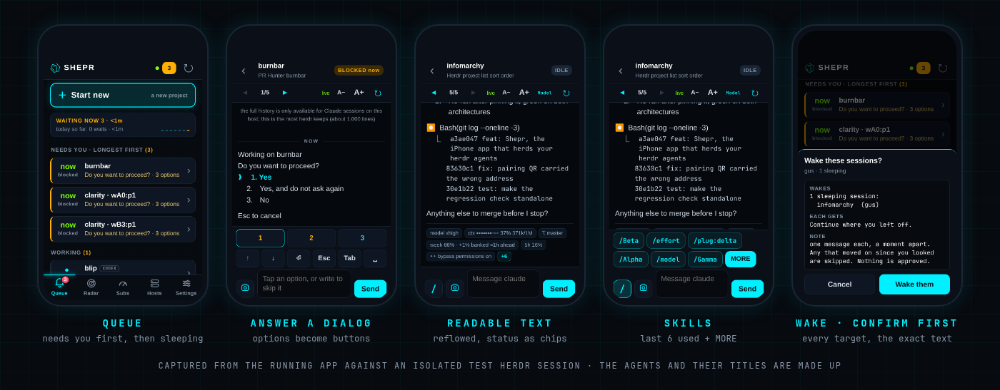

<p align="center"></p>

<p align="center"><b>An iPhone home-screen app that shows which agent sessions, on which hosts, are waiting on you.</b><br>
Tap one, read it, answer it. Sends confirm first, and it never approves anything by itself.</p>

A plain web page served over your tailnet. No Xcode, no App Store, no build step, no framework, no npm. It exists
because agents block on a question and then idle for an hour with nobody at the keyboard.

It works with [herdr](https://herdr.dev) today. Orca support is coming.

<p align="center"></p>

## How it fits together

<p align="center"></p>

The phone talks to **one** host. That host reaches the rest with `herdr --machine <label>` over the SSH keys you already
have. Nothing listens beyond `127.0.0.1`; `tailscale serve` is the only way in, and it only answers your tailnet.

It is HTTPS because it has to be: iOS refuses WebCrypto (the phone's key), the camera (the QR scan) and service
workers on plain `http://`. `tailscale serve` supplies a real certificate on your tailnet name.

## Use it

```bash
# once, on the machine that runs herdr (needs python3, tailscale, herdr on PATH, and qrencode for the QR):
git clone https://github.com/nixfred/shepr && cd shepr
# ~/.local/bin or ~/bin, whichever this PATH already searches first. Otherwise ~/.local/bin.
bindir=$(printf '%s\n' "$PATH" | tr ':' '\n' | while IFS= read -r d; do
  [ "$d" = "$HOME/.local/bin" ] || [ "$d" = "$HOME/bin" ] || continue
  printf '%s\n' "$d"; break
done)
[ -n "$bindir" ] || bindir="$HOME/.local/bin"
mkdir -p ~/.config/systemd/user "$bindir" && ln -sf "$PWD/server.py" "$bindir/shepr"
case ":$PATH:" in *":$bindir:"*) ;; *) export PATH="$bindir:$PATH" ;; esac
cat > ~/.config/systemd/user/shepr.service <<EOF
[Unit]
Description=Shepr

[Service]
WorkingDirectory=$PWD
ExecStart=/usr/bin/python3 $PWD/server.py 8742
ExecStartPost=/usr/bin/tailscale serve --bg --https=8742 http://127.0.0.1:8742
ExecStopPost=-/usr/bin/tailscale serve --https=8742 off
Restart=on-failure
RestartSec=3

[Install]
WantedBy=default.target
EOF
systemctl --user daemon-reload && systemctl --user enable --now shepr
shepr pair                                                           # shows a QR code
```

The link goes in `~/.local/bin` or `~/bin`, whichever comes first on `PATH`. If neither does, this paste uses `~/.local/bin` and adds it for this shell. The unit written here is named `shepr`. A nixweb install keeps the unit name it already chose.

On the iPhone, in **Safari**: open `https://<this-host>.<your-tailnet>.ts.net:8742`, Share, **Add to Home Screen**. Open
**Shepr** from the Home Screen, tap **Scan QR**, point it at the code in your terminal, tap **Pair**.

<p align="center"></p>

## What is on screen

| Tab | What |
|---|---|
| **Queue** | Everything, in the order that matters: **Needs you** (longest blocked first), **Finished**, **Working**, then **Sleeping** last (with a **Wake…** button). Sessions are named after your herdr workspace ("Shepr"), falling back to the project directory. Badge shows what needs you. | It refreshes itself every 10 s while the app is open and the moment you come back to it; pull down from the top of any list to refresh on demand.
| **Radar** | Every session on every host as a radar, with the counts (waiting, finished, working, idle) and the longest wait above it (below). |
| **Subs** | Your Claude, Codex, Kimi and Grok subscriptions on one animated page: how much of each plan is used, and whether you are banked, on pace or behind (below). |
| **Hosts** | Hosts herdr can reach (turn saved ones on or off) and a tailnet scan for more. |
| **Settings** | Four sections that each fit one screen. **Display**: text size, splash screen (Full, Short or Off), animations, which tab to open on, how often to refresh, slash commands, top spacing. **Alerts**: notifications. **Phones**: this phone's key, the phones the host trusts (revoke), pair another, forget this one. **About**: the build, gestures, reload, clear unsent drafts. Two links sit at the very bottom: nixfred.com and this repository. |

The Queue and Radar show **every host at once**; each session carries a coloured pill naming its machine (`GUS`, `VIC`), and the chips on top (`All hosts`, `gus 3`, `vic 1`) are only a filter if you tap one. `SHEPR_LOCAL_ONLY=1` makes the server ignore remote machines (the tests use it).

Every session is called by its **project** (the directory it runs in), with herdr's session title, the last thing it
worked on, underneath. Two sessions in one project get their pane id so you can tell them apart.

### Moving around

There is no Go tab: **hold any tab**, or tap a session's title, to search every session by project, title or host.

<p align="center"></p>

None of these ever sends anything.

In a session, **swipe left** for the next open project and **swipe right** for the previous one (the same order as the arrow
buttons). The swipe has to be quick, mostly sideways and at least 70 px, and it is ignored when it starts in the message box
or the key dock, or while you are selecting text, so it cannot fight scrolling or typing.

### Reading a session

The pane is a terminal: 100+ fixed-width columns. On a phone that wraps mid-line with no alignment, so Shepr
re-lays it out. Prose reflows in the normal font with a hanging indent (bullets and numbers stay aligned), code,
tables, paths and tool output stay fixed-width, rules become thin dividers, an empty prompt box is one divider, and the status bar under the prompt becomes a
compact strip of chips: model, context, banked / weekly subscription, 5h window, branch and permission mode, with
the rest behind one **+N** tap. **A−** / **A+** change the size (it remembers). Text only ever goes through `textContent`: whatever an
agent prints is data, never markup.

**The whole session is one scroll.** Under the live text, above a quiet "now" line, sits the entire conversation: just scroll
up and keep going, as far back as the first message. herdr only keeps about 1,000 lines, so for Claude sessions on the
host this reads the transcript file instead, a page at a time from the newest end (50 MB is fine), and adds each older
page above what you are reading without moving it. What the live text already shows is hidden from the history so nothing
appears twice, and new activity is pulled in as the session grows so there is never a gap. Tool calls show as one line,
tool results are cut to the first 700 characters, thinking is left out. Other hosts and other agents (not Claude) fall back
to the ~1,000 lines herdr keeps, and the top of the scroll says so.

### Skills and slash commands

In a session, tap **/** next to the message box (or just type `/`): a row shows the **last 6 skills and commands you
actually used**, newest first (read from Claude Code's own prompt history on the host). Tap one and it fills the box
with `/name `; it never sends. **MORE** opens a searchable list of everything on the host (your skills, plugin skills,
built-in commands), matching names and descriptions. Typing `/be…` filters the row as you go. `/exit` and `/quit` are
never offered as a one-tap chip, and a session sitting at a dialog gets no slash row (typing goes into the dialog).
A slash command still goes through the preview-and-confirm sheet like any prompt. For a remote host only the built-in
commands are listed: its skills are not read from here.

### Start new

The big **Start new** button at the top of the Queue opens a sheet with two tabs. **New project** (the first) makes a brand-new project. It asks for a **project name** (what shows on
the herdr title bar) and a **folder** under `~/Projects` (suggested from the name, and refused unless it is one plain name: no
slash, no leading dot or dash). The confirm sheet then shows the name, whether the folder will be created or already exists,
the exact command, and what the `ccc` alias expands to on this host, and nothing happens until you confirm. Then herdr makes
the project in the background (it does not take over your screen) and types `mkdir -p ~/Projects/<folder> && cd
~/Projects/<folder> && ccc` into it. Override the command with `SHEPR_NEW_CMD` and the base folder with `SHEPR_PROJECTS`.

An optional **First message** gives the new project its opening task: it is appended to the command as one quoted word
(`ccc 'fix the login bug'`), so quotes, `$`, backticks and `;` in it are just text and can never run anything. One line, up to
500 characters; the confirm sheet shows it.

**Existing folder** (the second tab) opens a folder you already have as a herdr project, without creating anything. The host lists the
folders directly inside `~/Projects` that herdr has no terminal in (the same plain names Start new accepts), newest conversation first,
with a `git` mark and when Claude or Codex last ran there. Search narrows the list. **Resume last** (the default) continues the last
conversation in that folder and is offered only where there is one; **Fresh session** starts a new one. Tap **Claude** or **Codex** on a
folder and the confirm sheet shows the project name, that the folder already exists and nothing in it will be created or changed, and the
exact command (`cd ~/Projects/<folder> && ccc --continue`, or `codex resume --last`). A folder that is not there is refused: this tab never
runs `mkdir`. It works on the machine Shepr runs on, so other machines are not listed.

### Photos and files

The camera button next to the message box attaches photos, a PDF or plain text files (`txt md log json csv`) from your phone: pick up to ten at once, give each its own comment, add more, or remove one before it uploads.
A photo is shrunk to 2000 px on the phone first (a PNG screenshot under 4 MB is sent as is, so text stays sharp). It is uploaded
signed, to this host only, checked by its first bytes rather than its name or the type the phone claims (programs and scripts
are refused), stored `0600` under `~/.local/state/shepr/uploads/<date>/` with a random name, and **deleted after a week**
(the folder is also kept under 300 MB). The saved paths are then placed in the message box (each on its own line with its comment under it) for you to add a note and Send, so
uploading sends nothing to anyone and the confirm sheet shows the exact text. Claude Code reads a path like that as an
image attachment. Sessions on another host are refused, because the file would be on the wrong machine. Up to 8 MB per file.

### Notifications

**Settings > Alerts > Turn on notifications** (iPhone only offers this to an app on the Home Screen, iOS 16.4 or later). Then
an agent that blocks buzzes your phone, and the app icon shows how many are waiting. Optionally also when one finishes.
How it works: the host sends an **empty** web push ("something changed"), signed with its own VAPID key (made once, kept `0600`).
The phone's service worker then asks the host what changed, signed with the phone's key, and shows project names only, never a
conversation title, because a notification can be read on a locked screen. So nothing about your sessions passes through Apple.
The host only sends to the real push services (Apple, FCM, Mozilla, Windows), never to an address a phone makes up, never
follows a redirect, and sends a phone at most one push every 20 seconds. Only blocked and finished states the host watched begin
count, not what was already true when it started. Revoking a phone removes its subscription. Tapping a notification opens that session.

### Waiting ledger

A slim strip under **Start new** shows how long agents sat blocked on you today (`TODAY 4 waits · 1h 12m`, longest, and a 7-day
mini chart). It turns amber and leads with **WAITING NOW** while something is blocked. Tap it for the week and the longest waits.
Only waits the host watched from the first moment to the last are counted (a wait already going when the host started, or one that
ended while it was not watching, is left out), one per blocked state, so a multi-step dialog is one wait. Kept 30 days in
`waits.jsonl` (`0600`).

### Fleet radar

The **Radar** tab shows every session as a radar. The centre is "needs you"; the rings run outward: waiting, finished, working,
idle. Each host has its own sector. Waiting dots pulse, swell the longer they wait, and carry the project name. Tap a dot to open
that session. With the iPhone's Reduce Motion on, the sweep and the pulses stand still.


### Subscriptions

The **Subs** tab has one card per subscription (Claude, Codex, Kimi, Grok) and answers "how much have I burned, and am I on pace?". Each
card has the plan used so far, a burn-down graph (the dashed diagonal is an even spend; above it is over, and the dotted line is
where your current rate lands at the reset) and a verdict: **BANKED 32%** when you have used less than the clock has,
**BEHIND** when you are more than 5% past an even spend, **ON PACE**, or **SPENT**. Every window of the plan (the week, the 5-hour session, Fable weekly) is listed as a bar with a marker for the clock, and the
countdown (how long the bank is, or when to come back if you stop now) ticks live. The page animates in once when you open it: the cards slide in, each curve draws itself, the bars fill and the numbers climb (Reduce Motion skips that). The numbers are measured by Shepr itself (`usage.py`), on the host, and need no other app:

- **Claude**: Claude Code's own login file is read, and its token is sent to Anthropic's usage endpoint (a read-only GET over HTTPS) and nowhere else. It is never refreshed by Shepr, never logged and never sent to the phone.
- **Codex**: its own session files, which record the plan limits on every turn.
- **Grok**: the credits line it logs when it starts.
- **Kimi**: only when `KIMI_API_KEY` is set, in Shepr's environment or as that one line in `~/.env` (nothing else in that file is read).

A provider that is not installed is not shown. One that is installed but cannot be read says why on its card (`Sign-in expired`, `Not signed in here`, rate limited). Codex and Grok write their figures only when they run, so after 20 minutes their numbers carry a `~` and the card says when they were measured. The history behind the graphs is Shepr's own (`usage-samples.jsonl`, private to you, pruned), so a new install draws its curves from the day it starts. `SHEPR_USAGE=0` turns the meter off entirely. The pace rules (even spend, banked, the burn-down, the occasional friendly reset) are ported from [Burn Bar](https://github.com/nixfred/burnbar), which does the same job in an Omarchy bar; Shepr does not read Burn Bar's or Omarchy's files.

The page opens with one line of advice (the rules Burn Bar uses, ported): **USE CODEX NEXT**, and why (`32% of its week is banked, about 3d ahead, resets in 4d`), or **USE IT NOW** when a reset is under a day away with budget unspent, or **NOTHING HAS ROOM**. Only a subscription that is ahead of an even spend is ever suggested, one whose 5-hour window is nearly full never is, a snapshot such as Grok needs a bigger margin, and with fewer than two subscriptions there is nothing to choose between, so the line is not shown. Under it, which ones are resting and for how long.

### A live screen

The toolbar says `live` while the screen is being kept up to date and turns amber (`45s ago`) once it has stopped, so a stale screen cannot pass for a current one. The text stays pinned to the bottom while things reflow under it and never pulls you down while you are scrolled up reading. A session that is not Claude Code carries a small tag (`codex`).

### Model and effort

In a Claude session that is waiting for its next prompt, the **Model** chip next to the text-size buttons (it shows what the session is running, e.g. `Opus·high`) opens a sheet: Fable, Opus, Sonnet or Haiku, and low, medium, high, xhigh or max. It sends `/model <name>` or `/effort <level>` after the usual confirm sheet. Claude Code also saves the choice as its default for new sessions on that host, and the sheet says so. Not offered for Codex, or while the agent is working or waiting on a question.

### Wake a project that is asleep

At the bottom of the Queue, **Asleep (N)** counts herdr projects whose terminal has no Claude or Codex session running. **Wake…**
opens a searchable list, most recently used first, with **Resume last** or **Start new** at the top and **Claude** or **Codex**
on each project. Tapping one shows exactly what will be typed (`claude --continue`, `codex resume --last`, or a plain
`claude` / `codex`) and the directory, and nothing runs until you confirm. It refuses unless that terminal is sitting at an
idle shell prompt, so it can never type into a build, an editor or a running program, and it checks again at the moment you
confirm. Resume is greyed out for a project with no earlier conversation on this host. The commands can be changed with
`SHEPR_CLAUDE_CMD` and `SHEPR_CODEX_CMD` (the tests set them to an echo). Once started, the agent appears in the Queue within seconds.

### Wake

**Sleeping > Wake…** lists the idle sessions (all ticked) and one message (default "Continue where you left off.").
**Review** shows every target and the exact text; **Wake them** sends one prompt each, half a second apart. It only
ever touches **idle or finished** sessions: a blocked one is a question waiting on you, and is refused outright, so
this can never answer or approve a dialog. A session that moved on since you looked is skipped. It declines while
the host's load is above its core count.
**Tick-several questions** (Claude's multi-select, `[ ]` boxes): tap the numbers to tick them on your phone, then **Submit…** (or **Next…** inside a multi-question form) shows what will be ticked and which keys go, and you confirm. Each digit is sent as its own keypress, because Claude reads a burst of digits as pasted text and ticks nothing. "Type something" is not tickable from the phone yet.

## Sending

<p align="center"></p>

A send is two requests. `prepare` returns exactly what will happen (the keys, the text, which agent, what state it
is in) plus a one-use nonce. `commit` runs it. The preview is bound to the agent's `state_change_seq`: if the agent
moved on while you looked, nothing is sent. A failed send is reported and never retried; a failed write may still
have landed, and the message says so.

- **Words at a numbered question are never typed into it** (a digit would pick an option). Shepr keeps your message in view and offers **Skip and send**: Esc closes the question without answering it, Shepr waits until it has closed, then sends your message as an ordinary prompt. You review both steps first. If the question will not close, nothing is sent and your words stay in the box.
- A blocked agent gets keys, not prompts: option buttons (it works out the ↓ presses from the screen), an
  arrow/Enter/Esc pad, or a typed line. Options that read like approvals are marked amber and the confirm sheet says so.
- An idle agent gets a normal prompt. A working agent only accepts `Esc` (interrupt) or a queued prompt.
- No ctrl-chords from a phone. `SHEPR_READONLY=1` turns every write off.
- What you type in a session's box and do not send is kept for that session on this phone, so moving to another project and back
  finds it again. It never leaves the phone until you press Send.

## Pairing and keys

The phone makes an ECDSA P-256 key with `extractable: false`; it can sign with it and nothing can read it back.
`shepr pair` writes a one-time code (60 bits, 3 minutes, single use, stored hashed) and prints a QR of
`https://<host>:8742/#shepr-pair=XXXX-XXXX-XXXX`. The app scans it, sends its **public** key with the code, and the
host files it in `~/.local/state/shepr/devices.json`, like an `authorized_keys` entry.

Every later request is signed over `time, nonce, method, path, sha256(body)`. The host refuses a replay, a changed
path or method, an old timestamp, an unknown or revoked key. Five wrong codes in a minute locks pairing for a minute.

```
shepr pair [--ttl 180] [--png qr.png] [--json] [--no-wait]
shepr devices            # list paired phones with SSH-style SHA256 fingerprints
shepr revoke <name|id>   # sign a phone out now
```

**This is not an SSH key.** A home-screen web app cannot speak SSH or hold an OpenSSH key; WebCrypto can. The device
key authenticates the phone to Shepr. Hops from the host to other machines use ordinary SSH keys through herdr's
saved machines. On top of that, every request must come through tailscale from the node owner's login with the right
`Host` header; public funnel traffic, other tailnet users and cross-origin posts are refused.

## More hosts

**Hosts > Scan tailnet** tries `ssh` with this host's key, never prompting, to the online machines that **belong to
you** (nodes shared in from another user are never touched), and reports each as `ready` (herdr found: **Add**),
`needs key` (**Copy key** gives a one-line command that appends this host's public key to `authorized_keys`),
`first connect` (run `ssh host` once and check the fingerprint; Shepr never trusts a new host key on its own),
`no herdr` (checked on the plain PATH and in the login shell), or `unreachable`. Add and on/off go through the same
preview-and-confirm sheet and run `herdr machine add|enable|disable`.

## Honest limits

- "Blocked for" is measured: herdr gives an event counter, not a clock. The host polls herdr every 15 s and
  remembers when it first saw each blocked state; for local Claude sessions that were already blocked it uses the
  transcript's last-write time. A leading `≥` means it was already blocked when watching began.
- Tested against an isolated herdr session: the server, the signing scheme (WebCrypto signatures checked by the
  pure-Python verifier), QR generation and scanning (fake camera feed through jsQR), gestures, wake, tick-several
  questions, the text renderer, layout at iPhone 14 size, offline start, and a real tailnet scan. Paired and in use
  on one real iPhone (iOS 18.7); other devices and iOS versions are untested. `Settings > Display > Top spacing` exists because a
  real phone clipped the header.
- Tick-several questions: "Type something" is not tickable from the phone yet.
- Sending a prompt to an idle agent could not be exercised against a real agent in the isolated test session
  (herdr refuses a fake agent that is not the pane's foreground process).
- iOS may delete a Home Screen app's storage if it is removed; the key goes with it. Pair again.
- One Shepr per phone install: the app is served from one origin.
- The server listens on loopback and trusts `tailscale serve` to be the only way in. Another process on the same
  machine can reach that port directly and is not asked for the Tailscale identity header (which it could forge
  anyway). It still cannot read or send anything: every `/api` call except `hello` and `pair` needs a signature from
  a paired phone, and pairing needs a one-time code from `shepr pair`.
- Shepr polls every machine that is enabled in your herdr config. Machines you add from the Hosts tab are limited to
  your own tailnet nodes, but one you added to herdr by hand is yours to vouch for.

## Layout

```
server.py            static files, /ping, /api, and the shepr CLI (pair|devices|revoke). Standard library only.
usage.py             the subscription meter: Claude, Codex, Grok and Kimi plan usage, measured on the host. Standard library only.
index.html app.css app.js sw.js manifest.webmanifest
icons/               logo.svg, app icons, launch images (iOS shows these before any code runs)
vendor/jsQR.js       the one third-party file: Safari has no BarcodeDetector. Apache-2.0, see vendor/README.md
docs/img/            the graphics above (hand-built SVG) and real screenshots
tests/               ui.mjs, sw_offline.mjs, format.mjs, pair_cli_test.py, usage_test.py, fake-session.sh, shots.mjs
```

State: `~/.local/state/shepr/` (`devices.json`, `seen.json`, `pairing.json`, `usage-samples.jsonl`, `sends.jsonl` audit log), mode 0600.
Logs: `journalctl --user -u shepr -f`. The app shell is fetched network-first (2.5 s, then
cache) so a change shows on the next open and the app still opens offline.
The host also announces the current build (`/api/hello`, `/api/queue`). A Home Screen app can stay alive in iOS
memory for days, so a phone running an older build reloads itself at the first safe moment (on the list, nothing
typed, no sheet open); inside a session it shows an **Update** button instead. It never reloads under your thumb.

## Testing without touching real agents

```bash
tests/fake-session.sh up                       # isolated herdr session "hrtest" with fake agents
eval "$(tests/fake-session.sh env)"
export SHEPR_URL=http://localhost:8743 SHEPR_POLL=3 CLAUDE_HOME=$PWD/tests/fixtures/claude-home   # the UI test expects these fixture skills
SHEPR_CLAUDE_CMD='echo STARTED' SHEPR_CODEX_CMD='echo CODEX' SHEPR_NEW_CMD='echo CCC' SHEPR_PROJECTS=/tmp/shepr-projects SHEPR_PUSH_ALLOW=127.0.0.1:9988 CODEX_HOME=$PWD/tests/fixtures/codex-home python3 server.py 8743 &   # what is typed when you wake a project: echoes, so tests never start a real agent
node tests/ui.mjs; node tests/sw_offline.mjs; node tests/push_sw.mjs; node tests/format.mjs; python3 tests/pair_cli_test.py
python3 tests/menu_parse_test.py; python3 tests/server_hardening_test.py; python3 tests/history_test.py; python3 tests/push_test.py   # pure Python, no server needed
node tests/shots.mjs                           # regenerates docs/img/screens.png from the RUNNING app
tests/fake-session.sh down
```

The screenshots are captures, never mocks. The agents and their titles in them are made up.

## Credits and licence

MIT, see `LICENSE`. Built on [herdr](https://herdr.dev) (Apache-2.0) and [jsQR](https://github.com/cozmo/jsQR)
(Apache-2.0, vendored in `vendor/`).
