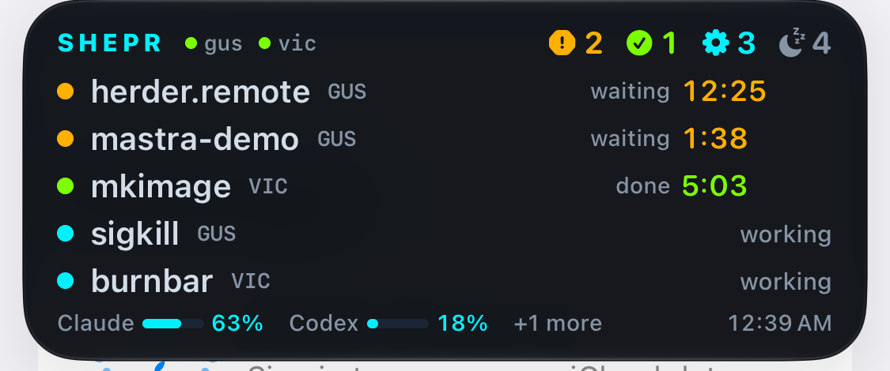
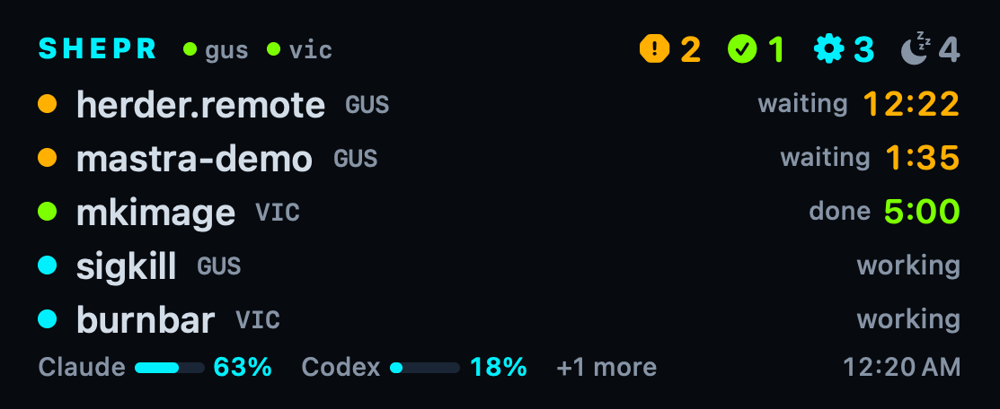
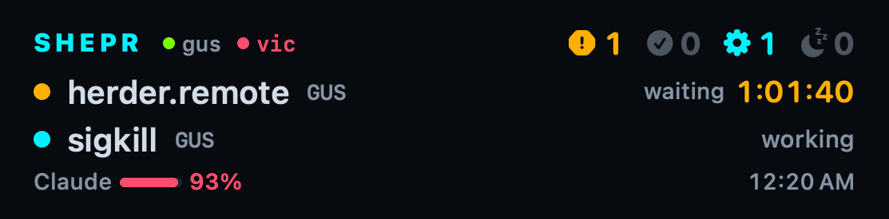
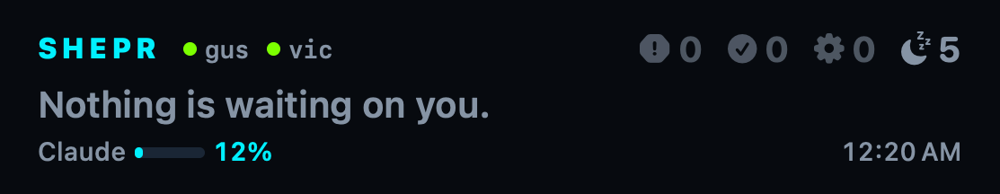

# Shepr Live

The optional native companion to Shepr. It puts the whole board on the iPhone Lock Screen as an Apple **Live Activity**: how many
sessions are waiting on you, finished and working, each session's name with a clock that counts up while it waits, which hosts
answer, and your plan meters. It is read-only. Nothing on it answers an agent, and a tap only opens the app.






The first picture is a capture of iOS 27.2 drawing the card, the others are the same view code drawn by `shepr-live-render`. All use made-up sessions.

## Why a second app

A Home Screen web app gets a notification and a badge on the Lock Screen and nothing else. A Live Activity needs a native app with
a widget extension, and that is the only reason this directory exists. The web app keeps its rules (no build step, no framework, no
npm). This is a separate, small Swift project that uses Apple frameworks only.

## What you need

- A Mac with Xcode, and `brew install xcodegen` (it turns `project.yml` into the Xcode project; the project file is not committed).
- An iPhone on iOS 18 or later, on your tailnet, and a Shepr host that is already running.
- An Apple ID. A free one is enough to install, but see "Free and paid" below.

## Build and install

```bash
cd ios
xcodegen generate
open ShepLive.xcodeproj
```

In Xcode, pick your Team for both targets (ShepLive and ShepLiveWidgets) under Signing & Capabilities, choose your iPhone, and Run.
On the phone, trust the developer under Settings > General > VPN & Device Management. If `com.nixfred.shepr.live` is taken for
your team, change `bundleIdPrefix` and the two `PRODUCT_BUNDLE_IDENTIFIER` lines in `project.yml` and run `xcodegen generate` again.

Then, on the machine that runs Shepr: `shepr pair`. In the app, scan the QR code (or paste the link under it) and tap **Start**.

## Free and paid

| | Free Apple ID (build configuration Free) | Paid Apple Developer Program (Push, Release) |
|---|---|---|
| Card refreshes | while Shepr Live is open | all the time, pushed by the host through Apple |
| Starts by itself when an agent blocks | no, tap Start | yes |
| App signing | expires after 7 days, re-run from Xcode | a year, or TestFlight |

Apple only lets a server update a Live Activity through its push service, and only a paid membership gives you the key for that.
With a paid account:

1. developer.apple.com > Certificates, Identifiers & Profiles > Keys > + > tick **Apple Push Notifications service (APNs)** > Continue > Register > Download. Keep `AuthKey_XXXXXXXXXX.p8`; the ten characters are the Key ID. Your Team ID is under Membership.
2. On the host: `shepr live setup --key AuthKey_XXXXXXXXXX.p8 --key-id XXXXXXXXXX --team-id YYYYYYYYYY` (add `--bundle` if you changed the bundle id).
3. In Xcode: Product > Scheme > Edit Scheme > Run > Build Configuration > **Push**, Run again, open the app once, tap Start. Debug builds talk to Apple's sandbox push service, so Push is the right configuration for a cable install. For TestFlight or ad hoc use **Release**, which uses the production service.
4. `shepr live status` shows the phone, and `shepr live test` pushes a plain "everything is connected" card to prove the path.

## What goes through Apple

Nothing readable. The host seals every update with ChaCha20-Poly1305 under a 32-byte key that only the host and the phone's Lock Screen
extension hold (the app makes it, keeps it in a Keychain group shared with the extension, and sends it to the host over the same signed
channel the web app uses). Apple sees ciphertext, its size and its timing. The one plain part is the banner Apple requires when a push
starts a card: "Live status is on your Lock Screen." The card shows names only, never a conversation title, and the names are marked
privacy sensitive so iOS can hide them when you ask it to.

## How it behaves

- The host builds the status once (`live.py`): counts, up to eight rows (blocked longest-waiting first, then finished in the last two hours, then working), host health, and the busiest window of each plan. The card shows five rows and counts the rest.
- It pushes when something changes, at most one update every 10 seconds, with the immediate priority only when an agent starts or stops waiting on you and the cheap priority otherwise, and once every 20 minutes even when nothing changed so a quiet card is not marked stale.
- Waiting clocks count up on the phone without any push.
- When a session becomes blocked and no card is up, the host starts one (push to start). It ends a card after 7 hours 45 minutes and starts a fresh one, because Apple ends a card at 8 hours. If you dismiss the card or tap Stop, the host leaves it alone until you tap Start again.
- Apple's limits: 160 points of height, 4 KB for the whole update, 8 hours active and at most 4 more on the Lock Screen.

## Tests

```bash
swift test                                   # models, the cipher, request signing, layout (a card is never taller than 160 pt)
swift run shepr-live-render out              # draws the cards to out/*.png and fails if one is taller than 160 pt
python3 ../tests/live_test.py                # the host side: cipher vectors, Apple headers and answers, routes, CLI
python3 ../tests/live_test.py --fixture > Tests/ShepLiveKitTests/Fixtures/sealed.json   # refresh the Python to Swift fixture
swift run shepr-live-probe --server URL --key FILE pair CODE   # a command-line phone, to test against a real server
```

Testing aids: launching the app with `-shepDemo` shows a made-up busy status and starts a card without a host, and `-shepDemoAlert`
also sends an update with an alert four seconds later, which makes iOS show the card as a banner (on a phone without a Dynamic
Island) or expand the island. To see the real thing in the Simulator (it needs the iOS Simulator runtime):

```bash
xcodebuild -project ShepLive.xcodeproj -scheme ShepLive -configuration Free -sdk iphonesimulator -destination "generic/platform=iOS Simulator" CODE_SIGN_IDENTITY="-" build
xcrun simctl install booted path/to/ShepLive.app
xcrun simctl launch booted com.nixfred.shepr.live -shepDemo -shepDemoAlert   # then open any other app within a second
xcrun simctl io booted screenshot card.png                                    # about four seconds later
```

The Simulator cannot lock the screen from the command line, so the Lock Screen presentation is seen as that banner. A card that
iOS keeps alive while the app is in the background is visible in `liveactivitiesd`'s log, not in a single screenshot.

## If the card does not update

- `shepr live status`: is Apple push set up, does the phone have a push-to-start token, how many cards are running.
- `shepr live test`: Apple's answer. `BadDeviceToken` usually means a sandbox token sent to the production service or the reverse (Debug builds are sandbox, Release is production). `InvalidProviderToken` means the key id or team id is wrong. `Unregistered` means the card is gone.
- On the Mac, the Console app shows `liveactivitiesd`, `apsd` and `chronod` for what the phone did with a push.
- iOS lets a person turn Live Activities off per app in Settings. The app says so when it cannot start one.
